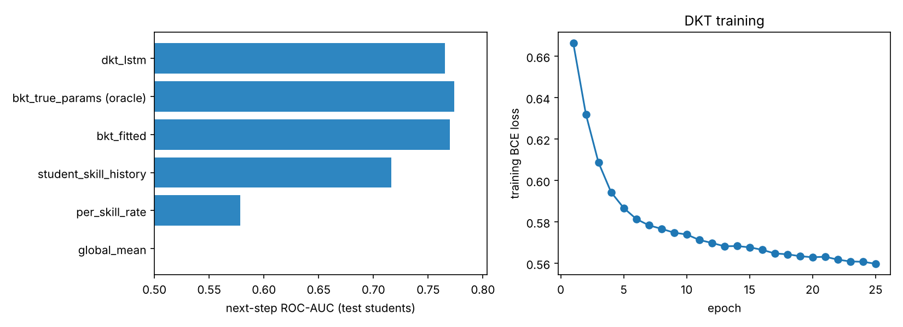

# Knowledge Tracing: BKT vs Deep Knowledge Tracing

**Knowledge tracing** predicts whether a student will answer the next question correctly, based on everything they have answered so far. It is the engine behind adaptive learning systems that decide what a student should practise next.

This repository implements and compares:

* simple baselines (global mean, per-skill difficulty, the student's own past accuracy on the skill);
* **Bayesian Knowledge Tracing (BKT)**, a classic hidden-Markov model of mastery, fitted per skill;
* **Deep Knowledge Tracing (DKT)**, an LSTM that learns student state from raw answer sequences (Piech et al., NeurIPS 2015).

## Data

Everything runs on **simulated students**, so the experiment is reproducible without access to private learning data:

* 12 skills with their own BKT parameters (initial knowledge, learning rate, guess and slip probabilities);
* a loose curriculum: questions move from early to later skills over the sequence;
* students differ in learning speed (a random "ability" term that plain BKT does not model);
* 2,400 training students and 600 test students, 60 questions each.

`kt/data.py` also loads real interaction logs in the ASSISTments format (`user_id, skill_id, correct, order_id`) into the same sequence format.

## Results (600 held-out students, 35,400 predictions)

| Model | Next-step ROC-AUC | Accuracy |
|---|---|---|
| Global mean | 0.500 | 0.565 |
| Per-skill difficulty | 0.579 | 0.577 |
| Student's past accuracy on the skill | 0.716 | 0.659 |
| BKT, parameters fitted by grid search | 0.770 | 0.709 |
| **DKT (LSTM, 64 hidden units)** | **0.765** | **0.704** |
| BKT with the *true* simulation parameters (oracle ceiling) | 0.774 | 0.711 |



### What I learned

* **Modelling each student's history matters most.** Going from skill difficulty alone (0.58) to a student's own history (0.72) gives the biggest jump.
* **DKT gets within 0.008 AUC of the oracle without being told how students learn.** The data was generated by a BKT-style process, so BKT is the "right" model here and fitted BKT is slightly better (0.770). That DKT almost matches it from raw sequences is the interesting part. On real data, where learning does not follow BKT's assumptions, DKT's flexibility is usually its advantage.
* **The ceiling is low by design.** Guessing and slipping make even the true model reach only 0.774 AUC, which is a useful reminder that a single answer is a noisy signal of what a student knows.

## Reproduce

```bash
pip install -r requirements.txt
python scripts/run_experiment.py     # about 35 s on a 2-core CPU
pytest -q
```

Results are written to `results/results.json` and `results/comparison.png`.

## Layout

```
kt/simulate.py   BKT-based student simulator with curriculum and ability
kt/bkt.py        BKT inference + per-skill grid-search fit
kt/dkt.py        DKT model, training loop, prediction
kt/data.py       loader for ASSISTments-style CSV logs
scripts/run_experiment.py
tests/           simulator, BKT behaviour, DKT shape and no-future-leak checks
```

The tests include a check that DKT never sees the answer it is asked to predict (changing the last answer must not change any prediction).

## Next steps

* Run on the public ASSISTments 2009 dataset and compare with published DKT results.
* Add uncertainty to the predictions (e.g. MC dropout) so a teacher knows how sure the model is.
* Use the predicted knowledge state to recommend the next exercise.

## References

* C. Piech et al. *Deep Knowledge Tracing.* NeurIPS 2015.
* A. T. Corbett, J. R. Anderson. *Knowledge Tracing: Modeling the Acquisition of Procedural Knowledge.* User Modeling and User-Adapted Interaction, 1994.

## Author

**Kazi Rezwan Rashid**, Lecturer in Computer Science and Engineering, Siddheswari University College, Dhaka.
[LinkedIn](https://www.linkedin.com/in/rezwan.rashid) · [Website](https://rezwanrashid.pythonanywhere.com/)

Licensed under the MIT License.
